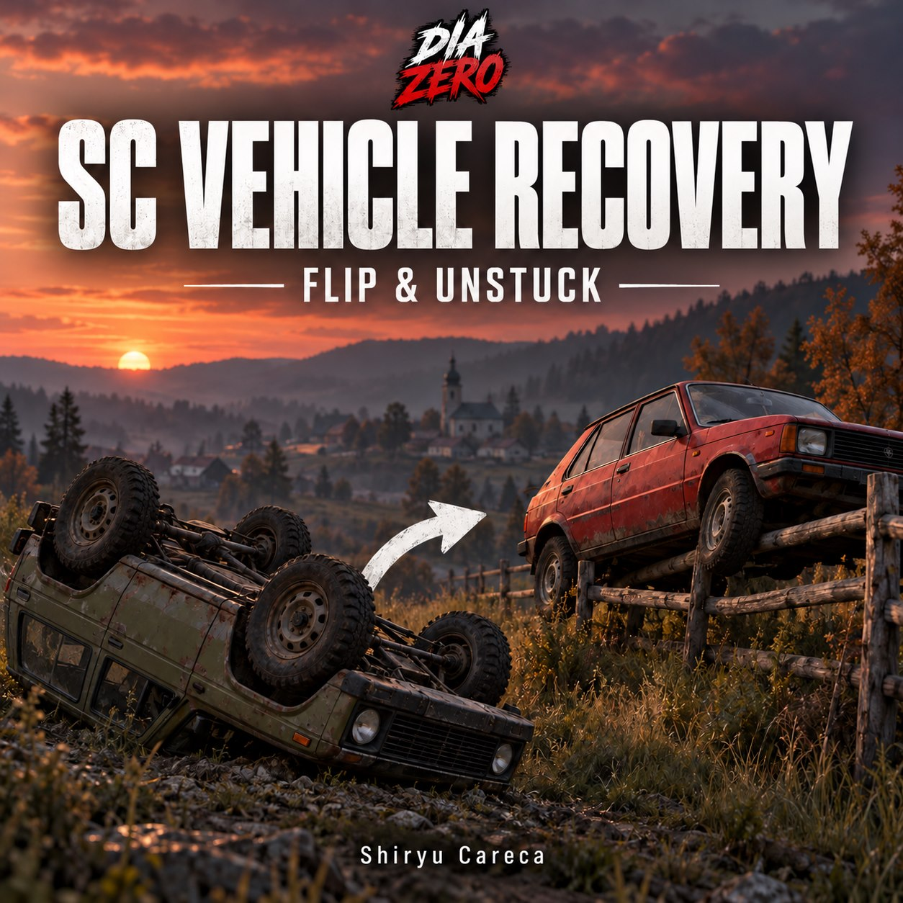
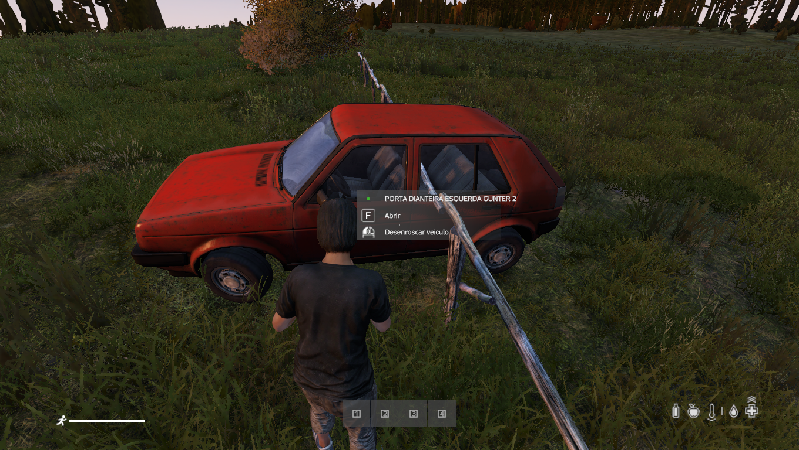
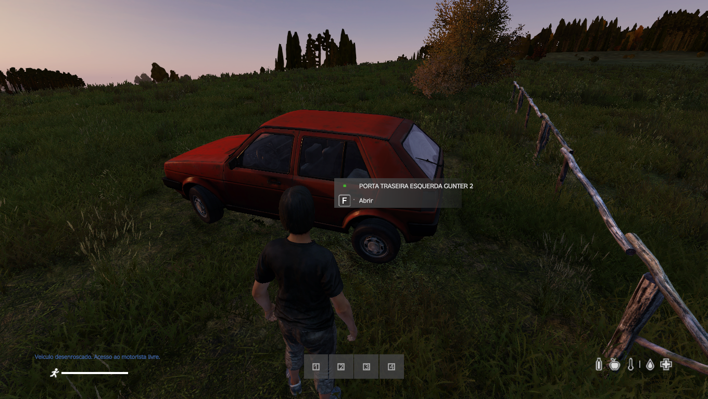
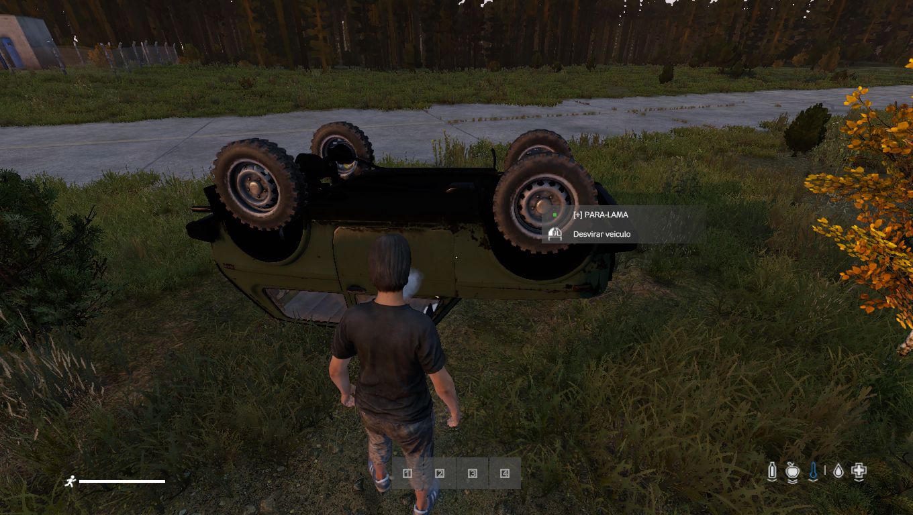

# SC Vehicle Recovery

**DayZ mod source by Shiryu Careca | DiaZero.**

[Português do Brasil](README.pt-BR.md) · [Steam Workshop](https://steamcommunity.com/sharedfiles/filedetails/?id=3830250592)



Two contextual **native DayZ actions**, using the attack control shown by the game:

- **Desvirar veiculo** — flip a tipped or overturned vehicle upright.
- **Desenroscar veiculo** — recover an upright car only when physical geometry obstructs its body or driver entry. It is not available for a clear car in an open field. Nearby people and loose inventory items do not qualify as an obstruction.

The player must get out, approach with empty, lowered hands, and leave every seat unoccupied. Vehicle cargo can stay inside. Recovery searches up to **8 meters**, checks collisions, water, uneven ground and driver entry clearance, and refuses to move when no safe position is found. Players cannot select an arbitrary teleport destination. Eligibility is checked again on the server before moving.

The same vehicle entity is retained. The mod does not repair damage, replace missing parts, or refuel vehicles. Successful unsticking has a 60-second cooldown per car; unsuccessful attempts have a 10-second delay.

## Source only

This repository contains **source code, documentation and images only**. It intentionally contains no PBOs, signatures, or signing keys. Ready-to-use binaries are distributed separately through the Workshop. CF, COT and VPP are not dependencies of the mod.

```
src/SC_VirarCarros/       Addon config and Enforce Script source
tools/build_pbo.py       Optional local PBO packer (Python standard library)
mod.cpp                  Mod metadata source
docs/                    Steam descriptions in PT-BR and English, plus image links
assets/                  Cover and real gameplay screenshots
```

## Local build

Requires Python 3.10+ to package the source:

```sh
python tools/build_pbo.py --check
python tools/build_pbo.py
```

The second command creates `dist/@SC_VehicleRecovery/addons/SC_VirarCarros.pbo` and copies `mod.cpp`. Build output is ignored by Git. The packer does not compile or validate Enforce Script and does not sign the addon. For a signed server distribution, use your own DayZ Tools signing workflow outside this repository; never commit private keys.

Load the resulting mod on **both server and clients** with `-mod=@SC_VehicleRecovery`. Do not load the same addon twice through a standalone mod and a modpack.

## Compatibility and configuration

Locally tested with vanilla cars on DayZ 1.30. Modded vehicles need `CarScript` inheritance, valid collision geometry and correct driver entry points. Compatibility depends on their implementation. Action labels are currently Portuguese. This version does not generate a JSON configuration file; recovery limits and checks are defined in the source.

The source does not include test missions, spawned test cars, admin settings, user identities or server persistence data.

## Screenshots

### Vehicle recovery



### Clear driver access after recovery



### Flip action



## Steam descriptions

- [Português do Brasil](docs/Steam_PT_BR.txt)
- [English](docs/Steam_EN.txt)
- [Both languages](docs/Steam_PT_EN.txt)
- [Direct image links](docs/image-links.txt)

The descriptions include the three real screenshot URLs and the like/favorite GIF.

**Created by Shiryu Careca | DiaZero.** Shared with the community. If you enjoy the mod, please leave a thumbs up and add it to your Workshop favorites.
