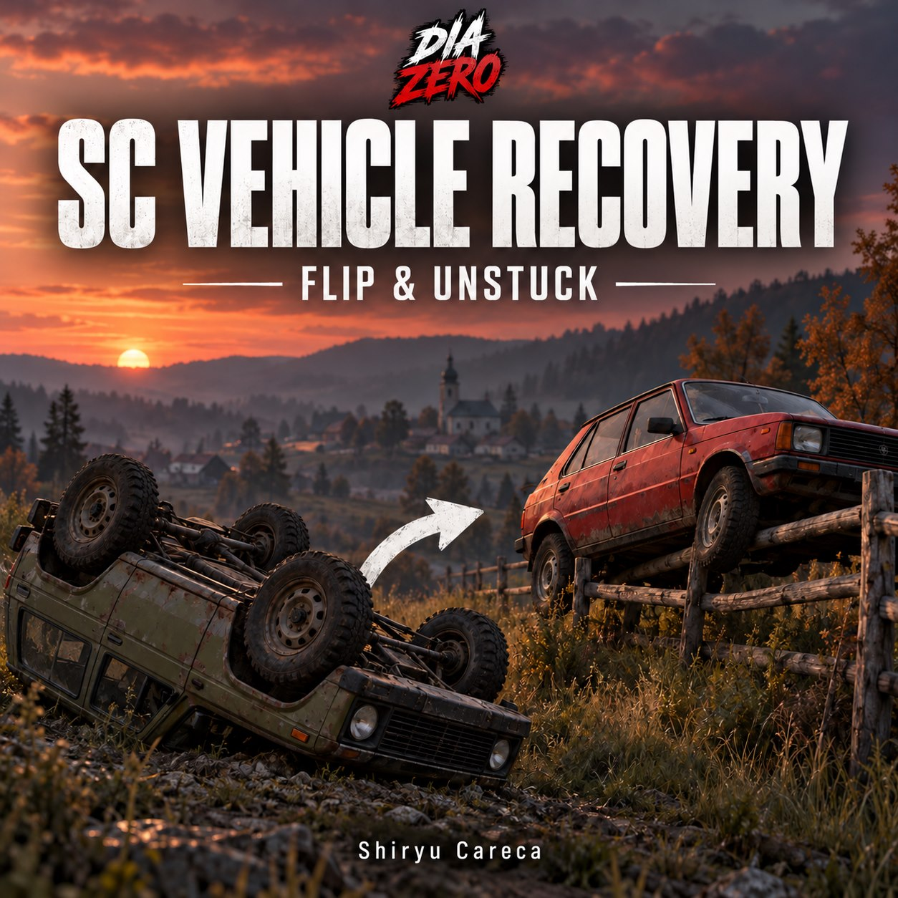
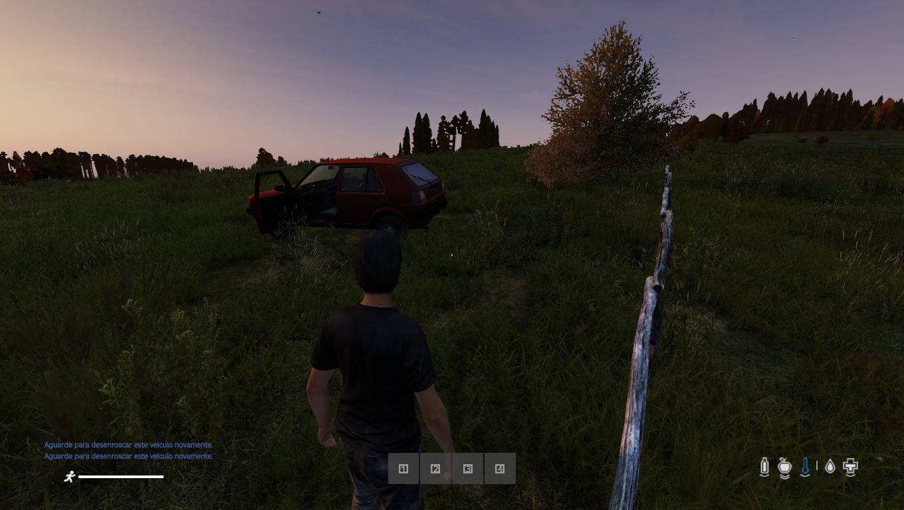
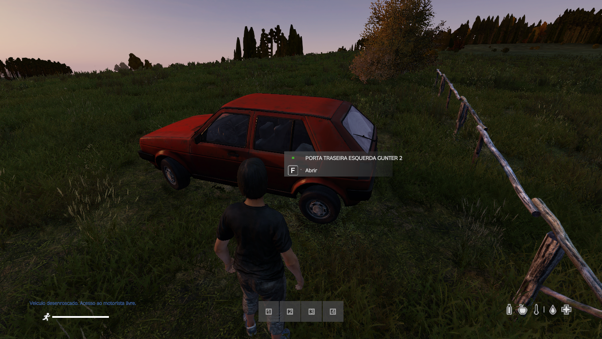
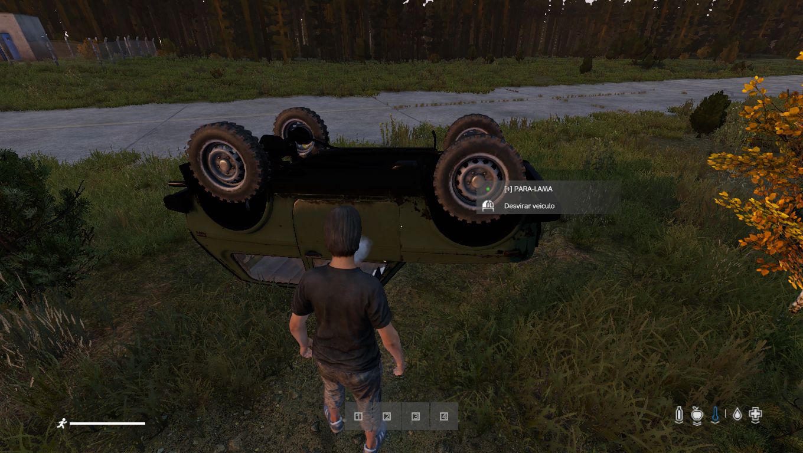

# SC Vehicle Recovery

**Código-fonte do mod DayZ, por Shiryu Careca | DiaZero.**

[English](README.md) · [Steam Workshop](https://steamcommunity.com/sharedfiles/filedetails/?id=3830250592)



## Duas ações nativas

- **Desvirar veículo:** coloca de pé carros tombados ou capotados.
- **Desenroscar veículo:** só aparece em um carro em pé com obstrução física na carroceria ou na entrada do motorista. Não fica disponível em campo livre. Pessoas próximas e itens soltos não contam como bloqueio.

Saia do carro, fique com as mãos livres e abaixadas, aproxime-se e use o botão de ataque indicado pela interface. O carro precisa estar parado e sem ocupantes. **A carga pode permanecer dentro.**

O servidor procura uma posição a até **8 metros**, conferindo colisões, água, desnível e espaço para entrar pelo lado do motorista. O jogador não escolhe o destino pelo cursor. Se não houver posição segura, não move o carro. A obstrução é conferida novamente no servidor antes da operação.

A operação mantém a mesma entidade e seu inventário. Não repara danos, não repõe peças e não reabastece. Intervalo de 60 segundos entre movimentos bem-sucedidos do mesmo carro; 10 segundos entre tentativas sem sucesso.

## Conteúdo deste repositório

**Somente código-fonte, documentação e imagens. Sem PBO, assinaturas ou chaves.** Os binários são distribuídos separadamente pelo Workshop.

- `src/SC_VirarCarros`: configuração do addon e scripts Enforce.
- `tools/build_pbo.py`: empacotador local opcional, usando apenas a biblioteca padrão do Python.
- `mod.cpp`: metadados do mod.
- `docs`: descrições da Steam PT-BR, inglês e bilíngue com links das imagens.
- `assets`: capa e três screenshots reais.

## Construção local

Requer Python 3.10 ou mais recente:

```sh
python tools/build_pbo.py --check
python tools/build_pbo.py
```

O segundo comando gera `dist/@SC_VehicleRecovery/addons/SC_VirarCarros.pbo` e copia o `mod.cpp`. O diretório `dist` é ignorado pelo Git. O empacotador não compila nem valida os scripts Enforce e não assina o addon. Para distribuição assinada, utilize seu fluxo de assinatura no DayZ Tools fora deste repositório. Nunca envie chaves privadas ao GitHub.

Carregue o mod resultante no **cliente e no servidor** com `-mod=@SC_VehicleRecovery`. CF, COT e VPP não são dependências. Não carregue duas cópias do mesmo addon no standalone e em um modpack.

## Compatibilidade

Testado localmente com carros vanilla no DayZ 1.30. Veículos de mods precisam herdar `CarScript` e fornecer geometria de colisão e pontos de entrada corretos; a compatibilidade depende do modelo. As ações estão em português. Esta versão não gera JSON de configuração: os limites estão definidos no código-fonte.

Não há missões de teste, configurações de admin, identidades de jogadores ou dados de persistência do servidor neste repositório.

## Ilustrações

### Recuperação do veículo para fora da cerca



### Acesso ao motorista livre após a recuperação



### Ação nativa para desvirar



## Textos para a Steam

[PT-BR](docs/Steam_PT_BR.txt) · [Inglês](docs/Steam_EN.txt) · [Bilíngue](docs/Steam_PT_EN.txt) · [Links diretos das imagens](docs/image-links.txt)

**Autoria e desenvolvimento: Shiryu Careca | DiaZero.** Disponibilizado para a comunidade. Gostou do trabalho? Deixe um joinha e adicione o mod aos favoritos na Steam.
